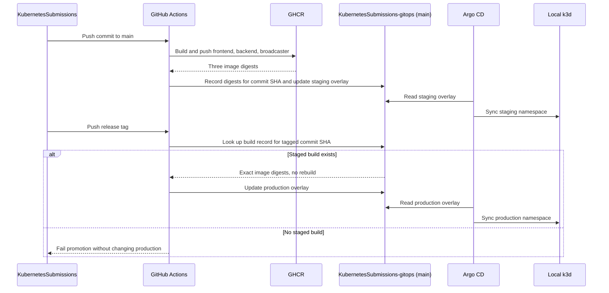

# Todo GitOps

Argo CD syncs local k3d from this repository’s `main` branch. Application code and the [promotion workflow](https://github.com/ehye/KubernetesSubmissions/blob/main/.github/workflows/todo-environments.yaml) live in `KubernetesSubmissions`.

| Namespace | Desired state | Image source |
|---|---|---|
| `staging` | [Staging overlay](overlays/staging) | Build from source `main` |
| `production` | [Production overlay](overlays/production) | Tagged commit’s staging digests |
| `project` | [Local exercise](todo_app/overlays/k3d) | Images imported into k3d |

## CI/CD flow



- **[Build records](builds)** answer “Which images did we build from this commit?” Each `<source-commit>.json` lists the exact GHCR digests for the frontend, backend, and broadcaster. When a release is tagged, production reuses those images instead of rebuilding them.
- **[Current promotions](promotions)** answer “Which source commit did CI select for each environment?” `staging.json` and `production.json` each record the commit and GitHub Actions run number. These describe the intended release; check Argo CD for what is actually synced and healthy.

Provision Secrets outside Git, then register the [Argo CD Applications](argocd):

```sh
kubectl --context=k3d-k3d-test apply -f argocd/
kubectl --context=k3d-k3d-test -n argocd get applications
```
