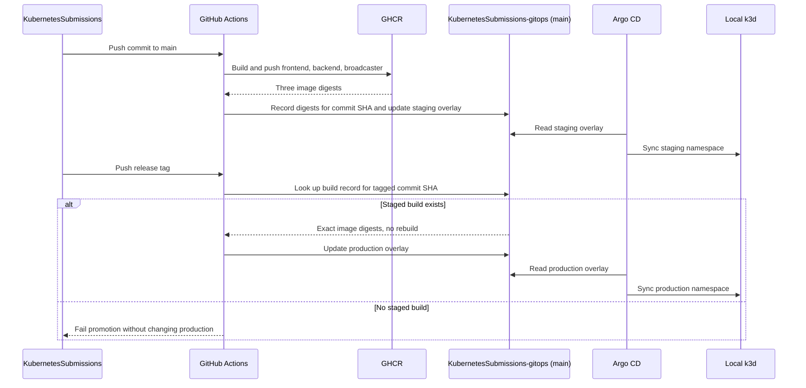

# Todo GitOps

Argo CD reads this repo’s `main` branch to deploy Todo on local k3d. The [source workflow](https://github.com/ehye/KubernetesSubmissions/blob/main/.github/workflows/todo-environments.yaml) uses the `todo-gitops-bot` GitHub App to get a short-lived token with write access to this repo only. CI commits image digests; Argo CD deploys them.

- `overlays/staging/` and `overlays/production/` pin each environment’s images and reference its Kustomize configuration under `todo_app/overlays/`.
- `builds/<source-commit>.json` records the exact frontend, backend, and broadcaster image digests built for that commit.
- `promotions/staging.json` and `promotions/production.json` record the source commit and workflow run selected for each environment. Check Argo CD for live health.
- `argocd/` defines the Applications, including the original `project` app at `todo_app/overlays/k3d/`.

## CI/CD flow



Provision Secrets outside Git, then register the Applications:

```sh
kubectl --context=k3d-k3d-test apply -f argocd/
kubectl --context=k3d-k3d-test -n argocd get applications
```
